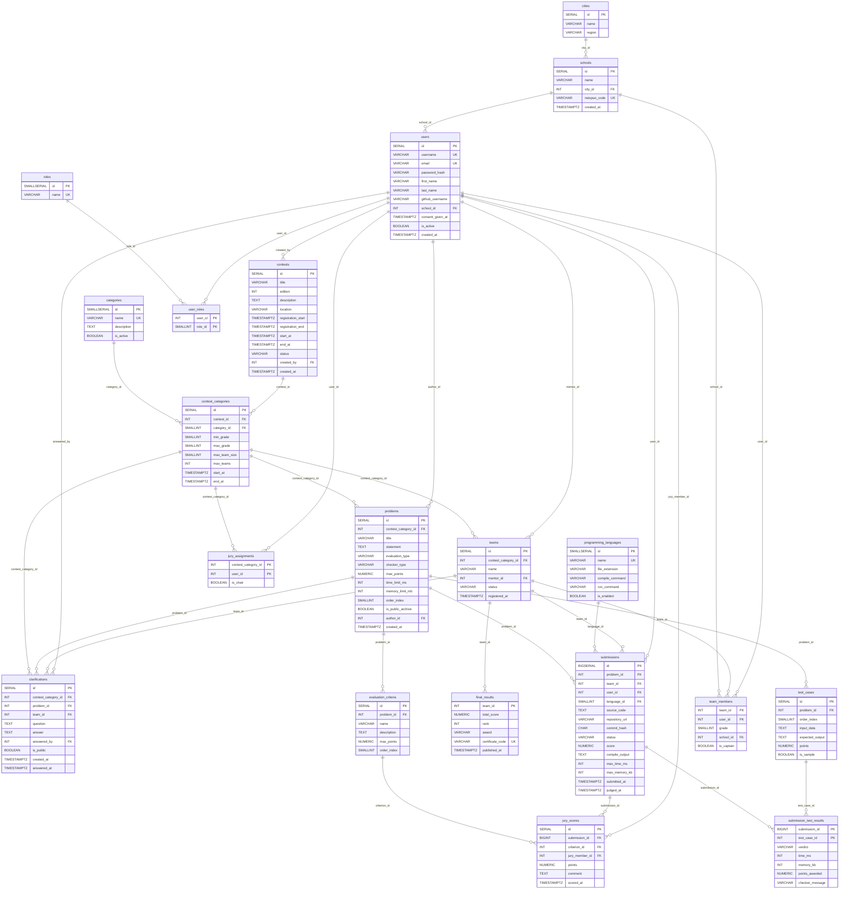

# База данни

Начална версия на базата данни (Етап 1). СУБД: **PostgreSQL 16**.

| Файл | Съдържание |
|------|------------|
| [`schema.sql`](schema.sql) | 20 таблици, ограничения, 2 тригера и 2 изгледа |
| [`seed.sql`](seed.sql) | Демо данни: 1 издание, 2 направления, 5 отбора, 11 решения |

## Пускане

```bash
createdb competition
psql -d competition -f database/schema.sql
psql -d competition -f database/seed.sql
psql -d competition -c "SELECT * FROM v_standings ORDER BY contest_category_id, rank;"
```

## Групи таблици

| Група | Таблици |
|-------|---------|
| Хора и училища | `users`, `roles`, `user_roles`, `schools`, `cities` |
| Състезания и направления | `contests`, `categories`, `contest_categories`, `jury_assignments` |
| Участие и резултати | `teams`, `team_members`, `clarifications`, `final_results` |
| Задачи | `problems`, `test_cases`, `evaluation_criteria`, `programming_languages` |
| Решения и оценяване | `submissions`, `submission_test_results`, `jury_scores` |

## Основни решения

1. **Два вида задачи.** `problems.evaluation_type` е `Auto` (проверка с тестове) или `Jury` (оценка от жури по критерии).
2. **Индивидуалното участие е отбор от един човек.** Решенията, класирането и наградите винаги сочат към `teams`.
3. **Издание → направление → възрастова група.** `contest_categories` пази класовете, размера на отбора и часа на провеждане.
4. **Класът и училището се пазят към момента на записване** в `team_members`.
5. **Класирането на живо е изглед** (`v_standings`), а официалното е замразено в `final_results`.
6. **Правилата от регламента са в базата** чрез тригерите `trg_check_team_member` и `trg_check_jury_score`.

## ER диаграма


