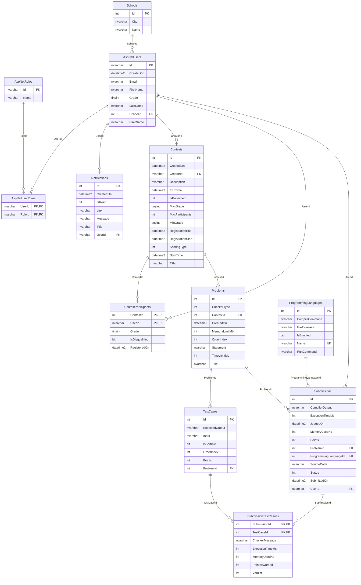

# База данни

## Технологии

- **СУБД:** Microsoft SQL Server (при разработка – SQL Server LocalDB).
- **Достъп до данните:** Entity Framework Core 8, подход **Code First**. Таблиците се описват с C# класове (Entities), а базата се създава и променя с **миграции**.
- **Потребители и роли:** ASP.NET Core Identity. Класът `ApplicationUser` разширява `IdentityUser` с име, фамилия, клас и училище.

Кодът на базата е в проекта `src/OnlineCodingCompetition.Data`:

| Папка | Съдържание |
|-------|------------|
| `Entities/` | 10 класа-модела на таблиците |
| `Enums/` | `ScoringType`, `CheckerType`, `SubmissionStatus`, `TestVerdict` |
| `Configurations/` | Връзки, индекси, check ограничения и HasData (Fluent API) |
| `Migrations/` | Миграцията `InitialCreate` |
| `Seeding/` | Начални демо данни |
| `ApplicationDbContext.cs` | Контекстът на базата |

## Таблици

| Таблица | Entity | Предназначение |
|---------|--------|----------------|
| `AspNetUsers` | `ApplicationUser` | Потребители: участници, организатори, администратори |
| `AspNetRoles`, `AspNetUserRoles` | Identity | Роли: Administrator, Organizer, Contestant |
| `Schools` | `School` | Училища на участниците |
| `Contests` | `Contest` | Състезания: срокове за записване и провеждане, правила за класиране, допустими класове |
| `ContestParticipants` | `ContestParticipant` | Записани участници (много-към-много между състезания и потребители) |
| `Problems` | `Problem` | Задачи: условие, лимит за време и памет, начин на сравняване на изхода |
| `TestCases` | `TestCase` | Тестове: вход, очакван изход, точки; примерните се показват в условието |
| `ProgrammingLanguages` | `ProgrammingLanguage` | Езици и командите за компилиране и изпълнение |
| `Submissions` | `Submission` | Изпратени решения: код, статус, точки, време и памет |
| `SubmissionTestResults` | `SubmissionTestResult` | Резултат на всяко решение по всеки тест |
| `Notifications` | `Notification` | Известия до потребителите |

Identity създава и `AspNetUserClaims`, `AspNetUserLogins`, `AspNetUserTokens` и `AspNetRoleClaims`, които не са показани на диаграмата.

## ER диаграма



## Правила при изтриване

| Връзка | При изтриване | Причина |
|--------|---------------|---------|
| Състезание → задачи, записани участници | изтриват се | Принадлежат само на състезанието |
| Задача → тестове | изтриват се | Принадлежат само на задачата |
| Решение / тест → резултати по тестове | изтриват се | Нямат смисъл без решението или теста |
| Потребител → известия | изтриват се | Лични са |
| Задача, потребител или език → решения | **забранено** | Решенията са история на състезанието и влизат в класирането |
| Организатор → състезания | **забранено** | Състезанието не изчезва заедно с организатора |
| Потребител → записвания | **забранено** | Класирането трябва да остане пълно |
| Училище → потребители | полето става празно | Потребителят остава, но без училище |

Няма таблица, до която каскадното изтриване да стига от една и съща таблица по два различни пътя. SQL Server отказва да създаде такава база.

## Ограничения в базата

- `CK_Contests_RegistrationPeriod`, `CK_Contests_RegistrationBeforeStart`, `CK_Contests_Duration`: записването започва преди да свърши, приключва преди старта, а стартът е преди края.
- `CK_Contests_Grades`, `CK_AspNetUsers_Grade`: класът е между 1 и 12, а най-ниският допустим клас не е по-голям от най-високия.
- `CK_Problems_TimeLimit`, `CK_Problems_MemoryLimit`: лимитите са положителни.
- `CK_TestCases_Points`, `CK_Submissions_Points`, `CK_SubmissionTestResults_Points`: точките не са отрицателни.
- Уникални индекси: един участник веднъж в състезание, неповтарящ се пореден номер на задача и на тест, уникално име на език, уникално училище в населено място.

Правилата, които зависят от текущия момент (записване само в срока, решения само по време на състезанието, класът на участника), се проверяват в бизнес логиката (`Services`) и ще се покрият с unit тестове.

## Начални данни (seeding)

1. **В миграцията (`HasData`)**: трите роли и петте езика (C++ 17, C# (.NET 8), Java 21, Python 3, JavaScript (Node.js)).
2. **При стартиране на приложението (`Seeding/`)**, ако `Seeding:Enabled` е `true` (по подразбиране е включено при разработка):
   - 3 училища;
   - 5 демо акаунта: администратор, организатор и трима участници;
   - приключило състезание с 2 задачи, 8 теста, 7 проверени решения и класиране;
   - предстоящо състезание с отворено записване;
   - 3 известия.

Всеки seeder проверява дали данните вече съществуват, затова повторното стартиране не ги дублира.

| Имейл | Роля |
|-------|------|
| `admin@example.com` | Administrator |
| `organizer@example.com` | Organizer |
| `contestant@example.com` | Contestant |
| `elena@example.com` | Contestant |
| `petar@example.com` | Contestant |

Паролата на демо акаунтите **не е в хранилището**. Задава се с User Secrets:

```bash
dotnet user-secrets set "Seeding:DemoPassword" "<парола>" --project src/OnlineCodingCompetition.Web
```

Без нея приложението стартира, но не създава демо акаунти и демо състезания.

## Миграции

```bash
# възстановяване на инструмента dotnet-ef (веднъж)
dotnet tool restore

# нова миграция след промяна на Entities
dotnet ef migrations add <Име> --project src/OnlineCodingCompetition.Data --startup-project src/OnlineCodingCompetition.Web

# прилагане към базата (приложението прави това и само при стартиране)
dotnet ef database update --project src/OnlineCodingCompetition.Data --startup-project src/OnlineCodingCompetition.Web
```

CI проверява при всеки push, че няма промени в модела без миграция (`dotnet ef migrations has-pending-model-changes`).
